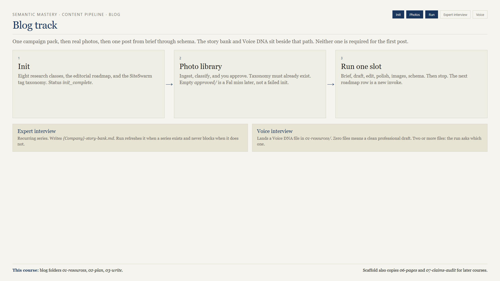
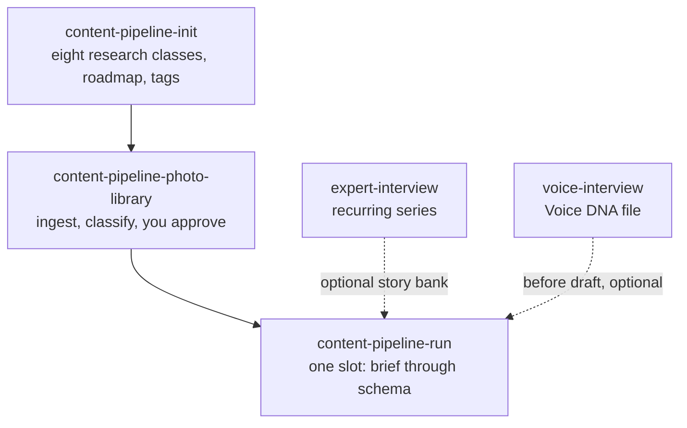

# 00 — Blog track map

Read this before you invoke a skill. Most failed runs are a skill used out of order.

## Who does what

| Skill | When | Owns | Leaves alone |
|---|---|---|---|
| `content-pipeline-init` | Once per campaign, then again only to fill a gap or rebuild the plan | `01-resources/` pack, `02-plan/editorial-roadmap.md`, `02-plan/siteswarm-tag-taxonomy.md` | Produce stages, photo approval |
| `content-pipeline-photo-library` | After `init_complete`, before the writing chat | `01-resources/image-library/` | Roadmap, article text |
| `content-pipeline-run` | One roadmap row per invoke | `03-write/3.1` through `3.6` for that slot | Research, the roadmap, first-time photo ingest |
| `expert-interview` | On a cadence, once product facts are already seated | Series link and `{Company}-story-bank.md` | Citable product facts |
| `voice-interview` | When you want the draft to sound like a recorded person | `{author}-voice-dna.json` in `01-resources/` | Article copy |

## The path for one post

1. **Init** until `content-pipeline-init-manifest.json` says `init_complete`. That means eight research classes, `ai-isms.md`, the roadmap, and the tag taxonomy.
2. **Photo library.** Classify, then you approve. An empty `approved/` folder does not fail init. At image time, a miss goes to Fal.
3. **Run** one slot: brief, draft, edit, polish, images, schema. Then it stops. The next post is a new invoke.
4. **Expert interview** can start once product facts are seated, and can keep running beside later posts. The run refreshes the story bank when a series record exists. No series record is fine.
5. **Voice interview** any time before the draft you want it to affect. Zero Voice DNA files means a clean professional tone.

## What this map leaves in the scaffold

The template also copies `06-pages/` and `07-claims-audit/`. Those folders are for later courses. This course uses `01-resources/`, `02-plan/`, and `03-write/`. Publish and archive folders exist. The run skill does not write them.

## Manifests

| File | Written by |
|---|---|
| `06-content-pipeline/content-pipeline-init-manifest.json` | init |
| `06-content-pipeline/content-pipeline-run-manifest.json` | run |

After `/clear`, those files are the status. The chat transcript is not.
