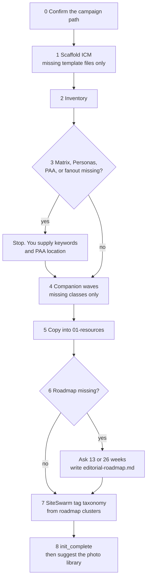

# 03 — content-pipeline-init

**Version 1.3.5. Once per campaign. Photo library and run both wait on it.**

## What it is for

Init does not write articles. It scaffolds the tree, sees which of the eight research classes are missing, dispatches the companion that owns each missing class, copies the files into `01-resources/`, then writes the roadmap and the tag taxonomy itself.

Trigger: `/content-pipeline-init`, "content pipeline init", or "initialize content pipeline", plus an explicit campaign folder.

## Confirm the campaign

The path must exist and look like a campaign (`CAMPAIGN-CONTEXT.md` and/or `01-intake/`). Init repeats the absolute path before it writes. No path, no writes.

## Eight steps



## The three waves

Parallel inside a wave. The next wave waits.

| Wave | Dispatches | Waits on |
|---|---|---|
| 1 | `business-dossier` | Your yes before a paid compose |
| 2 | `dataforseo-onpage-crawl`, Content Maxima Matrix, Content Maxima Personas, `dataforseo-paa-queries`, `dataforseo-fanout-queries` | Dossier domain for the crawl. Your keywords for Matrix, Personas, PAA, and fanout. Your yes before the crawl. |
| 3 | `product-documentation`, `customer-research` | Product documentation waits until dossier and on-page files are on disk |

Matrix and Personas are two dispatches of the same `contentmaxima` skill. A failed companion is recorded. Init does not fabricate the file. If anything is still missing after the waves, it stops before the roadmap.

You can skip a companion by placing the file yourself, then re-running init. Sync copies what inventory can see.

## Copy rules worth knowing

- Dossier: markdown only into `01-resources/`. Leave the `.docx` in intake.
- Product documentation: `01-intake/1.1-docs/Product-Documentation.md` is canonical. Sync mirrors it into `01-resources/` when the bytes differ. If the mirror is newer than the canonical file, sync reports that and does not overwrite either one.
- Sync can copy one class: `--classes product_doc` (comma-separated). `--dry-run` lists what a real copy would write.
- Intake originals are left in place.

## Roadmap and tags

If `02-plan/editorial-roadmap.md` is already there, init reuses it unless you ask for a rebuild. Otherwise it asks **13** or **26**, records `plan.horizon_weeks`, reads `02-plan/CONTEXT.md`, and writes the markdown table only.

Tags come next. Init extracts the roadmap's Cluster values and writes `02-plan/siteswarm-tag-taxonomy.md`. Photo classify uses that file as the allowlist. A missing SiteSwarm site is fine. Missing taxonomy is not: classify will stop.

## Done

`init_complete` is the eight classes, `ai-isms.md`, the roadmap, and the taxonomy. Init then tells you to run the photo library. It does not start the scrape unless you say to do the library in this same session.

Scaffold copies missing template files and skips `AGENTS.md` and `.cursor/rules/`. The rules students follow are `PROJECT-RULES.mdc` in the pipeline folder.

If the client has the social posting add-on, init can mention `postiz-channel-auth` for a later call. It does not generate those links, and a missing add-on does not block `init_complete`.

Dossier compose stops when the Google Maps link cannot be resolved to a CID. Wave 1 still waits for your yes before a paid compose.

Resume: re-read the manifest, dispatch only classes that are still missing. If the resources are present and the plan is not, resume at the roadmap or the taxonomy. Do not re-run the research waves.

## Scripts

From the init skill folder, with your template env or `--template`:

```bash
node scripts/scaffold-icm.mjs --campaign-dir "C:\work\clients\ridgeline-tree-care"
node scripts/inventory-resources.mjs --campaign-dir "C:\work\clients\ridgeline-tree-care"
node scripts/sync-resources.mjs --campaign-dir "C:\work\clients\ridgeline-tree-care" --dry-run
node scripts/extract-roadmap-clusters.mjs --campaign-dir "C:\work\clients\ridgeline-tree-care"
```

The manifest is `06-content-pipeline/content-pipeline-init-manifest.json`.
