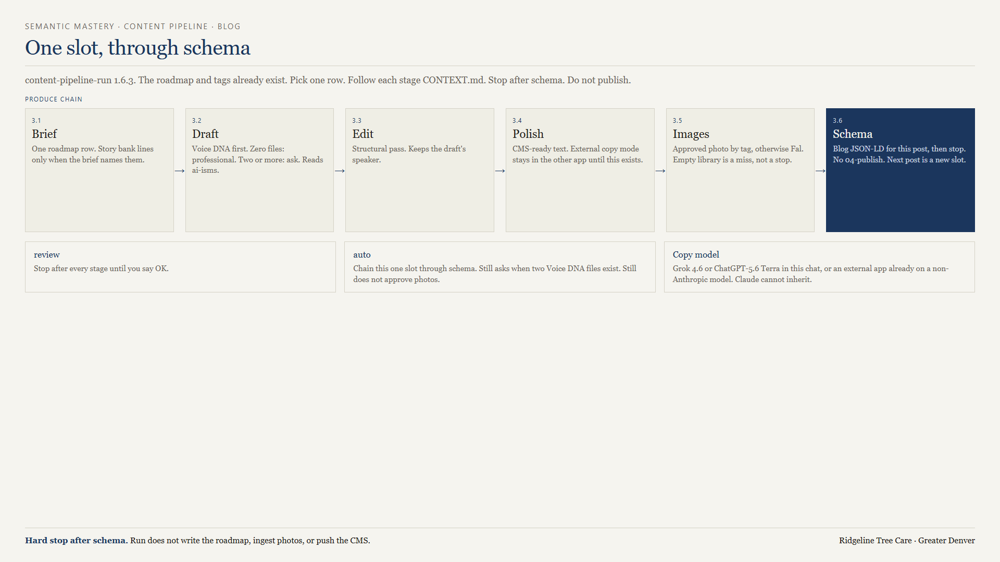
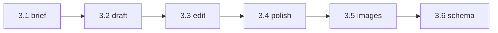

# 05 — content-pipeline-run



**Version 1.6.3. One roadmap slot. Brief through schema. Then stop.**

## What it is for

Produce one post from a finished init. Run does not research, does not write the roadmap, and does not build the photo library. It reads each stage's `CONTEXT.md` and follows that Agent prompt.

Trigger: "content pipeline run" or `/content-pipeline-run`, plus the campaign folder (the campaign, or `06-content-pipeline/` itself).

## Before any prose

1. Confirm the absolute campaign path.
2. Choose `gate_mode`: `review` or `auto`. See [01-gates.md](01-gates.md).
3. Choose `copywriting_model` if the manifest does not have one. Grok 4.6 or ChatGPT-5.6 Terra in this chat, or an external app that is already on a non-Anthropic model. A Claude chat cannot inherit its way into copy.

```bash
node scripts/check-ready.mjs --campaign-dir "C:\work\clients\ridgeline-tree-care"
node scripts/advance-run.mjs --campaign-dir "C:\work\clients\ridgeline-tree-care" --init --gate-mode review --copywriting-model inherit
```

`check-ready` requires `init_complete`, the eight resources, and `ai-isms.md`. When an expert series record exists, it refreshes the story bank. No series is fine. The story bank is never a reason to stop.

Missing roadmap or taxonomy: stop and go back to init. Run will not write either file.

## The slot

Ask for the post number, or the next incomplete row. Record week, title, and trigger word from that roadmap row.

```bash
node scripts/advance-run.mjs --campaign-dir "C:\work\clients\ridgeline-tree-care" --set-slot --post 7 --week 3 --title "Storm cleanup in Greater Denver" --trigger "storm damage"
```

One slot in this invoke. External copy mode stops here and hands you the whole brief-to-polish chain. You stay in the other app until polish exists. Images and schema run in this chat after that.

## The chain



| Stage | Folder | What it writes |
|---|---|---|
| brief | `03-write/3.1-brief/` | The piece brief for this row. Optional story-bank lines only if the brief lists entries under `Story bank entries used:`. |
| draft | `03-write/3.2-draft/` | The article. Reads `ai-isms.md`. Resolves Voice DNA first. |
| edit | `03-write/3.3-edit/` | Structural pass. Keeps the draft's speaker. |
| polish | `03-write/3.4-polish/` | CMS-ready text package. |
| images | `03-write/3.5-images/` | Library hit, otherwise Fal. Ignores the copy model pin. |
| schema | `03-write/3.6-schema/` | This post's JSON-LD. `WebPage` with `BlogPosting` as `mainEntity`. Overwrites the existing file for this slug under `02-deliverables/2.4-schema`. |

In `review`, each stage stops for your OK. In `auto`, the six stages chain, then stop. Either mode: do not open the next roadmap row in the same invoke.

Voice DNA, before draft:

| Files in `01-resources/` | Action |
|---|---|
| 0 | Clean professional tone |
| 1 | Use it. Do not ask. |
| 2 or more | Stop and ask which file is the author voice. Do not blend. |

Names that match: `*voice-dna*`, `*voice_dna*`, `*brand-voice*`, `*author-voice*`, `.json` or `.md`. When that file is a person, company and crew work is we / us / our, and that person's own calls and arrival are I / me / my. Do not name them in the third person. Do not import filler words. Edit and polish keep that speaker.

Images use `{pipeline}/scripts/match-library.mjs`, then `fal-generate.mjs` on a miss (`fal-ai/flux-2-pro`). Empty `approved/` is a Fal miss. Do not start photo ingest from this skill. If those two scripts are missing, seed them from the photo-library skill. Do not stop because a global skills folder is absent.

Schema does not call SiteSwarm. Publish and archive stay empty.

```bash
node scripts/advance-run.mjs --campaign-dir "C:\work\clients\ridgeline-tree-care" --produce-complete
node scripts/status-run.mjs --campaign-dir "C:\work\clients\ridgeline-tree-care"
```

On the next invoke, `status-run` is the resume point. Honor `next_action`. Do not redo a complete stage unless you ask for a rewrite. A stored Anthropic pin, or inherit while this chat is Claude, stops before more copy.

Another post: set a new slot. Same campaign, new invoke.
